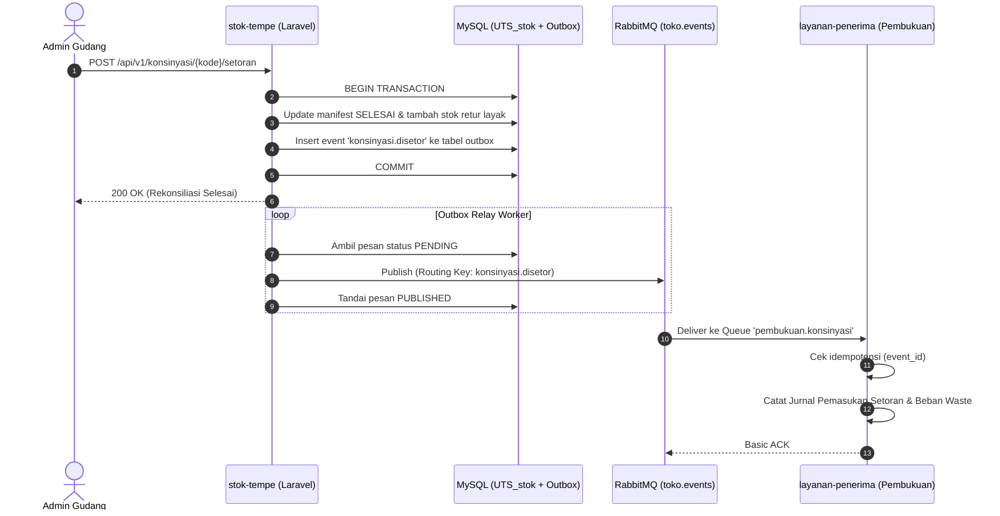

# FASE 4: PERANCANGAN KONTRAK EVENT ASINKRON (INTEGRASI CLOUD)
**Layanan Manajemen Stok & Konsinyasi Tahu Tempe**

**Mata Kuliah:** Integrasi Cloud (Semester 5)  
**Kelompok:** Anti-Normal  
**Message Broker:** RabbitMQ (AMQP 0-9-1)  
**Publisher:** `stok-tempe` (Layanan Gudang & Konsinyasi)  
**Consumer:** `layanan-penerima` (Layanan Pembukuan & Keuangan Usaha)  
**Tanggal Penyusunan:** 14 November 2026  
**Status Fase:** ✅ Selesai  

---

## 1. ARSITEKTUR TOPOLOGI MESSAGING & OUTBOX PATTERN

Untuk menjaga keandalan data lintas layanan menuju target UAS, komunikasi asinkron dirancang dengan mekanisme berikut:

1. **Exchange:** `toko.events` bertipe **`topic`** (durable), memungkinkan penambahan *consumer* baru di masa depan tanpa mengubah kode *publisher*.
2. **Transactional Outbox Pattern:** Layanan `stok-tempe` tidak langsung mengirim pesan ke RabbitMQ di dalam *HTTP Request* controller. Saat transaksi database berhasil disimpan, *event* ditulis terlebih dahulu ke tabel `outbox_messages` dalam satu `DB::transaction` yang sama, lalu dikirim oleh *worker* ke RabbitMQ. Hal ini menjamin pesan tidak hilang meskipun broker sempat mengalami gangguan.
3. **Idempotent Consumer (`event_id`):** Setiap pesan dilengkapi UUID unik (`event_id`). Layanan penerima (`layanan-penerima`) mencatat `event_id` yang sudah diproses agar pengiriman ulang (*at-least-once delivery*) tidak menyebabkan pencatatan ganda pada pembukuan.

### Diagram Alur Integrasi Lintas Layanan



### 3.1 Event: konsinyasi.diambil

Dikirim saat pedagang mengambil tahu/tempe di pagi hari.

```json
{
  "event_id": "550e8400-e29b-41d4-a716-446655440001",
  "event_name": "KonsinyasiDiambil",
  "routing_key": "konsinyasi.diambil",
  "version": "1.0",
  "occurred_at": "2026-11-15T06:00:00Z",
  "producer": "stok-tempe",
  "data": {
    "kode_manifest": "KSY-20261115-001",
    "tanggal_konsinyasi": "2026-11-15",
    "pedagang": {
      "kode_pedagang": "PDG-001",
      "nama_pedagang": "Pak Budi"
    },
    "estimasi_nilai_bawa": 220000,
    "items": [
      {
        "kode_produk": "TAHU-001",
        "nama_produk": "Tahu Putih",
        "harga_satuan_snapshot": 4000,
        "jumlah_dibawa": 30
      },
      {
        "kode_produk": "TEMP-001",
        "nama_produk": "Tempe Papan",
        "harga_satuan_snapshot": 5000,
        "jumlah_dibawa": 20
      }
    ]
  }
}
```

### 3.2 Event: konsinyasi.disetor

Dikirim saat setoran sore selesai direkonsiliasi. Payload ini menjadi dasar pencatatan jurnal keuangan otomatis di layanan-penerima.

```json
{
  "event_id": "550e8400-e29b-41d4-a716-446655440002",
  "event_name": "KonsinyasiDisetor",
  "routing_key": "konsinyasi.disetor",
  "version": "1.0",
  "occurred_at": "2026-11-15T16:00:00Z",
  "producer": "stok-tempe",
  "data": {
    "kode_manifest": "KSY-20261115-001",
    "tanggal_konsinyasi": "2026-11-15",
    "pedagang": {
      "kode_pedagang": "PDG-001",
      "nama_pedagang": "Pak Budi"
    },
    "ringkasan_keuangan": {
      "total_tagihan_setoran": 178000,
      "total_kerugian_waste": 12000,
      "mata_uang": "IDR"
    },
    "items": [
      {
        "kode_produk": "TAHU-001",
        "nama_produk": "Tahu Putih",
        "harga_satuan_snapshot": 4000,
        "jumlah_dibawa": 30,
        "jumlah_terjual": 22,
        "subtotal_setoran": 88000,
        "jumlah_retur_layak": 5,
        "jumlah_rusak": 3,
        "subtotal_kerugian": 12000
      },
      {
        "kode_produk": "TEMP-001",
        "nama_produk": "Tempe Papan",
        "harga_satuan_snapshot": 5000,
        "jumlah_dibawa": 20,
        "jumlah_terjual": 18,
        "subtotal_setoran": 90000,
        "jumlah_retur_layak": 2,
        "jumlah_rusak": 0,
        "subtotal_kerugian": 0
      }
    ]
  }
}
```