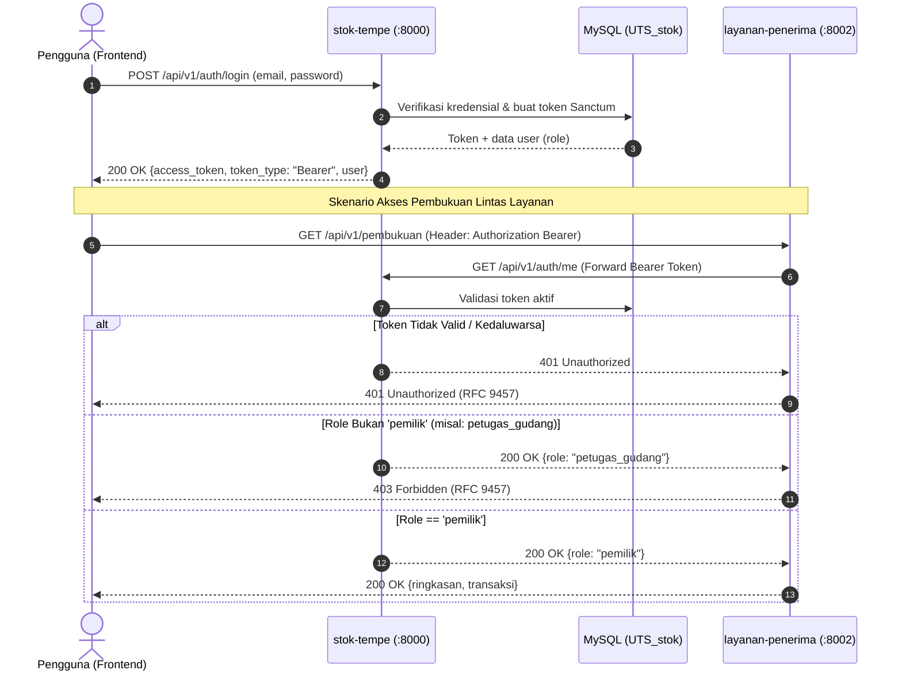

# FASE 5: ARSITEKTUR AUTENTIKASI & OTORISASI LINTAS LAYANAN (RBAC)
**Layanan Manajemen Stok Konsinyasi (`stok-tempe`) & Pembukuan (`layanan-penerima`)**

**Mata Kuliah:** Integrasi Cloud (Semester 5)  
**Kelompok:** Anti-Normal  
**Mekanisme Autentikasi:** Laravel Sanctum (Bearer Token)  
**Standar Error:** RFC 9457 Problem Details (`application/problem+json`)  
**Tanggal Penyusunan:** 25 November 2026  
**Status Fase:** ✅ Selesai  

---

## 1. LATAR BELAKANG PEMISAHAN HAK AKSES

Pada tahap integrasi antar-layanan dan persiapan antarmuka pengguna (*frontend*), akses terhadap API tidak lagi bersifat terbuka untuk publik. Dalam operasional usaha keluarga produsen tahu dan tempe, terdapat pemisahan tanggung jawab yang jelas antara **Pemilik Usaha** dan **Petugas Gudang**:

1. **Pemilik Usaha (`pemilik`):** Berwenang mengelola data master (katalog produk tahu/tempe beserta harga jual dasar serta daftar mitra pedagang) dan memantau laporan keuangan/jurnal pembukuan pada `layanan-penerima`.
2. **Petugas Gudang (`petugas_gudang`):** Berwenang menjalankan operasional harian di lantai gudang, yaitu mencatat hasil produksi harian masuk, menerbitkan manifest pengambilan pagi, dan melakukan rekonsiliasi setoran sore.

Untuk menegakkan pemisahan peran tersebut tanpa menduplikasi tabel pengguna di banyak database, `stok-tempe` bertindak sebagai **Identity & Token Provider** terpusat, sedangkan `layanan-penerima` memvalidasi token dan *role* secara *real-time* melalui komunikasi HTTP internal.

---

## 2. ARSITEKTUR AUTENTIKASI & VALIDASI LINTAS LAYANAN

1. **Penerbitan Token (`stok-tempe`):** Pengguna melakukan autentikasi melalui `POST /api/v1/auth/login`. Layanan memverifikasi kredensial menggunakan *hash* `bcrypt` dan menerbitkan *Personal Access Token* (Sanctum) beserta informasi `role`.
2. **Penegakan RBAC Lokal (`stok-tempe`):** Setiap permintaan ke *endpoint* terproteksi melewati *middleware* `auth:sanctum` (memastikan token valid $\rightarrow$ `401` jika gagal) dan *middleware* `EnsureUserHasRole` (memastikan `role` pengguna sesuai $\rightarrow$ `403` jika tidak berhak).
3. **Verifikasi Token Lintas Layanan (`layanan-penerima`):** Saat *frontend* mengakses `GET /api/v1/pembukuan` di port `8002`, *middleware* `VerifyPemilikToken` meneruskan *Bearer Token* ke `GET http://host.docker.internal:8000/api/v1/auth/me`. Jika token tidak valid atau *role* bukan `pemilik`, akses langsung ditolak sebelum menyentuh basis data pembukuan.

### Diagram Alur Autentikasi & Validasi Lintas Layanan



---

## 3. MATRIKS OTORISASI ENDPOINT (RBAC MATRIX)

Tabel berikut menjadi acuan baku bagi tim *frontend* dalam mengatur visibilitas menu, tombol aksi, dan proteksi rute halaman (*route guard*):

| Layanan | Method & Endpoint | Publik | `petugas_gudang` | `pemilik` | Keterangan Izin |
| :--- | :--- | :---: | :---: | :---: | :--- |
| `stok-tempe` | `POST /api/v1/auth/login` | ✅ | ✅ | ✅ | Autentikasi & penerbitan token |
| `stok-tempe` | `GET /api/v1/auth/me` | ❌ (`401`) | ✅ | ✅ | Cek profil & *role* token aktif |
| `stok-tempe` | `POST /api/v1/auth/logout` | ❌ (`401`) | ✅ | ✅ | Mencabut (*revoke*) token aktif |
| `stok-tempe` | `GET /api/v1/produk` | ❌ (`401`) | ✅ | ✅ | Lihat katalog & sisa stok gudang |
| `stok-tempe` | `POST /api/v1/produk` | ❌ (`401`) | ❌ (`403`) | ✅ | Tambah produk master baru |
| `stok-tempe` | `POST /api/v1/produk/{kode}/produksi` | ❌ (`401`) | ✅ | ❌ (`403`) | Catat hasil produksi harian masuk |
| `stok-tempe` | `GET /api/v1/pedagang` | ❌ (`401`) | ✅ | ✅ | Lihat daftar mitra pedagang |
| `stok-tempe` | `POST /api/v1/pedagang` | ❌ (`401`) | ❌ (`403`) | ✅ | Daftarkan mitra pedagang baru |
| `stok-tempe` | `GET /api/v1/konsinyasi` | ❌ (`401`) | ✅ | ✅ | Daftar manifest & filter status/tanggal |
| `stok-tempe` | `GET /api/v1/konsinyasi/{kode}` | ❌ (`401`) | ✅ | ✅ | Detail rincian item satu manifest |
| `stok-tempe` | `POST /api/v1/konsinyasi` | ❌ (`401`) | ✅ | ❌ (`403`) | Buat manifest pengambilan pagi |
| `stok-tempe` | `POST /api/v1/konsinyasi/{kode}/setoran` | ❌ (`401`) | ✅ | ❌ (`403`) | Proses rekonsiliasi setoran sore |
| `layanan-penerima` | `GET /api/v1/pembukuan` | ❌ (`401`) | ❌ (`403`) | ✅ | Laporan jurnal keuangan & waste |

---

## 4. STANDAR RESPONS GALAT KEAMANAN (RFC 9457)

Seluruh penolakan autentikasi (`401`) dan otorisasi (`403`) pada kedua layanan mengembalikan header `Content-Type: application/problem+json`.

### 4.1 Galat 401 Unauthorized (Tanpa Token / Token Tidak Valid)

```json
{
  "type": "https://localhost:8000/api/v1/problems/401",
  "title": "Tidak terautentikasi",
  "status": 401,
  "detail": "Token autentikasi tidak disertakan, tidak valid, atau sudah kedaluwarsa."
}
```

### 4.2 Galat 403 Forbidden (Role Tidak Memiliki Izin)

```json
{
  "type": "https://localhost:8000/api/v1/problems/403",
  "title": "Akses ditolak",
  "status": 403,
  "detail": "Role pengguna (petugas_gudang) tidak memiliki izin untuk membuka buku pembukuan."
}
```